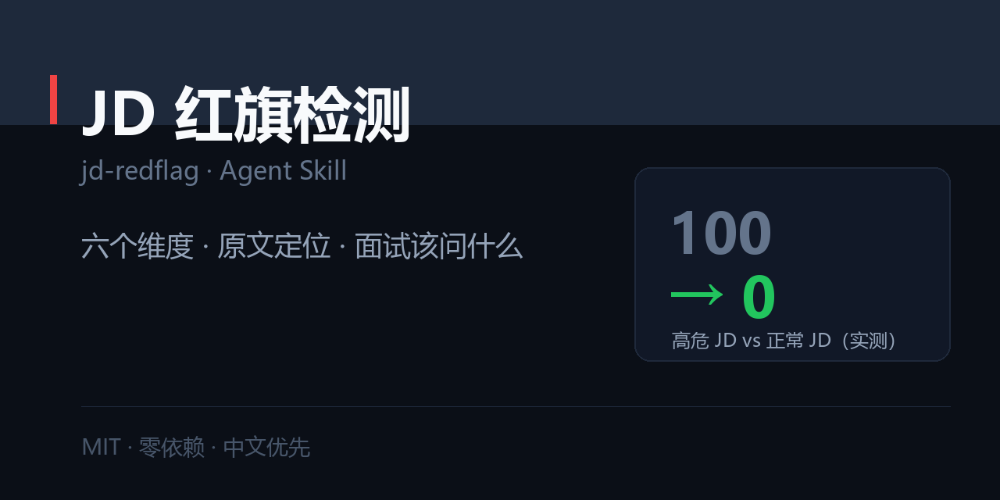

# JD 红旗检测 · jd-redflag

> 把「抗压能力强」「薪资面议」「一人多岗」这些话说回原形，并告诉你面试该问什么。



[](./SKILL.md)
[](./LICENSE)
[](#)

---

## 一句话

```
$ python scripts/scan_jd.py jd.txt

风险分：100/100    高危：建议只当练手，去的话逐条问清
命中：高危 5 · 中危 9 · 提醒 4   （JD 267 个汉字）

【文化与话术】7 条
  [中危] 「大家庭」        含义：用情感替代制度与报酬
  [高危] 「不要只看钱」     含义：钱给不到位
【加班与作息】3 条
  [高危] 「抗压能力强」     含义：会加班，且大概率没有加班费
  [高危] 「高强度」        含义：明确告诉你强度高
…

【JD 没写的（比写了的更值得警惕）】
  - 薪资区间：没写薪资区间：大概率低于市场，或想看你报多少
  - 五险一金：没写社保：入职前必须问清什么时候开始缴
  - 工作时间：没写工时：默认按最差的假设（大小周或更差）
  - 团队规模：没写团队规模：可能是新设岗，或这个岗只有你一个人
```

同一份脚本跑一份正常 JD：**0 分，零命中，无缺失项**。

完整报告见 [`examples/01-scan-report.md`](./examples/01-scan-report.md)。

---

## 为什么不是「让 AI 分析一下这个 JD」

| | 让 AI 自由分析 | 用这个 Skill |
| --- | --- | --- |
| 输出 | 「这个 JD 有些风险，建议谨慎」 | 风险分 + 命中的**原文** + 真实含义 |
| 可比较 | 不能 | 两份 JD 能排队比谁更坑 |
| 可复现 | 每次不一样 | 纯规则，同一份 JD 永远同一分数 |
| 落地 | 说完了你还是不知道怎么问 | 每条红旗配一句**不得罪人的面试问法** |
| 盲区 | 容易漏掉「没写的东西」 | 单独检查薪资/社保/工时/团队规模缺失 |

核心主张只有一句：**红旗的作用不是让你拒掉 offer，是让你在面试里问出来。**

## 安装

```bash
git clone https://github.com/zhbehx/jd-redflag.git ~/.claude/skills/jd-redflag
```

## 用法

```bash
# 基础扫描
python scripts/scan_jd.py jd.txt

# 看每条红旗的真实含义与面试问法
python scripts/scan_jd.py jd.txt --explain

# 卡阈值：风险分超 60 退出码 1（可挂 CI，帮招聘方自查 JD 写法）
python scripts/scan_jd.py jd.txt --fail-over 60

# 结构化输出
python scripts/scan_jd.py jd.txt --json
```

## 六个维度

| 维度 | 看什么 | 例 |
| --- | --- | --- |
| 加班与作息 | 抗压、狼性、大小周、弹性工作 | 「抗压能力强」= 会加班且没加班费 |
| 薪资陷阱 | 面议、底薪+提成、试用期打折 | 「薪资 5K–20K」= 实际 5K |
| 职责混乱 | 一人多岗、身兼数职、领导交办 | 「其他一切事务」= 边界无限 |
| 文化与话术 | 大家庭、主人翁、能者多劳 | 「不要只看钱」= 钱给不到位 |
| 承诺模糊 | 期权、上市、成长空间 | 不要算进你的收入 |
| 合规风险 | 押金、无薪试岗、不签合同 | 这些可以直接判死 |

**分档**：≥60 高危 ｜ 30–59 需核实 ｜ <30 相对正常

## 一个额外的检查：职责比要求长

```
⚠️ 岗位职责比任职要求长 1.5 倍以上：典型的活多钱少结构
```

职责写 7 条、要求写 1 条，说明它在找「能干很多事、门槛很低」的人。

## 仓库结构

```
jd-redflag/
├── SKILL.md                      # 三条前提 + 六维 + Step 0–5 + 交付格式 + 反模式
├── references/
│   └── redflag-lexicon.md        # 每条红旗：原文 → 真实含义 → 面试怎么问
├── scripts/
│   └── scan_jd.py                # 风险分 / 证据 / 缺失项 / 职责长度比
├── examples/
│   ├── 01-scan-report.md         # 完整报告长什么样
│   └── fixtures/                 # 高危 JD / 正常 JD（CI 冒烟用）
└── market/social-preview.png     # 社交预览图
```

## 三个诚实的局限

1. **只认词，不认语境。** 一家真给钱的狼性公司也会被打高分——分数是让你去问，不是让你判死。
2. **截图会丢字。** 直接贴文本比截图准确。
3. **扫不出「太完美」的坑。** 有些 JD 毫无红旗，但公司成立三个月、搜不到产品。这一层脚本做不了，需要拿 JD 去交叉验证公司信息。

## 自定义

1. **加你们行业的黑话**：`scripts/scan_jd.py` 顶部 `RULES` 列表，一条正则加一句话就生效。
2. **改扣分权重**：`LEVEL_PENALTY`（当前 H=15 / M=7 / L=3）。
3. **改缺失项检查**：`MISSING_CHECKS`。

## FAQ

**Q：分数低就一定好吗？**
A：不一定。低分只说明「没说坏话」。真正要看的还有公司是否真实存在、产品是否上线、团队有没有人。

**Q：为什么不直接告诉我投不投？**
A：除了明显违法项（押金、无薪试岗），其他都该你自己判断。「狼性 + 高薪」对有些人就是好选择。

**Q：招聘方能用吗？**
A：能，反向用。`--fail-over 60` 跑一遍自己写的 JD，能发现哪些措辞会把候选人吓跑。

## License

[MIT](./LICENSE)
